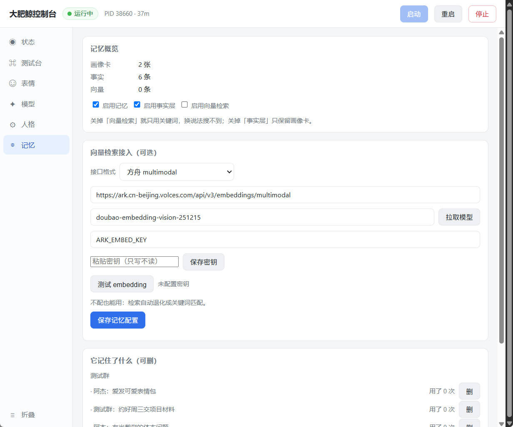
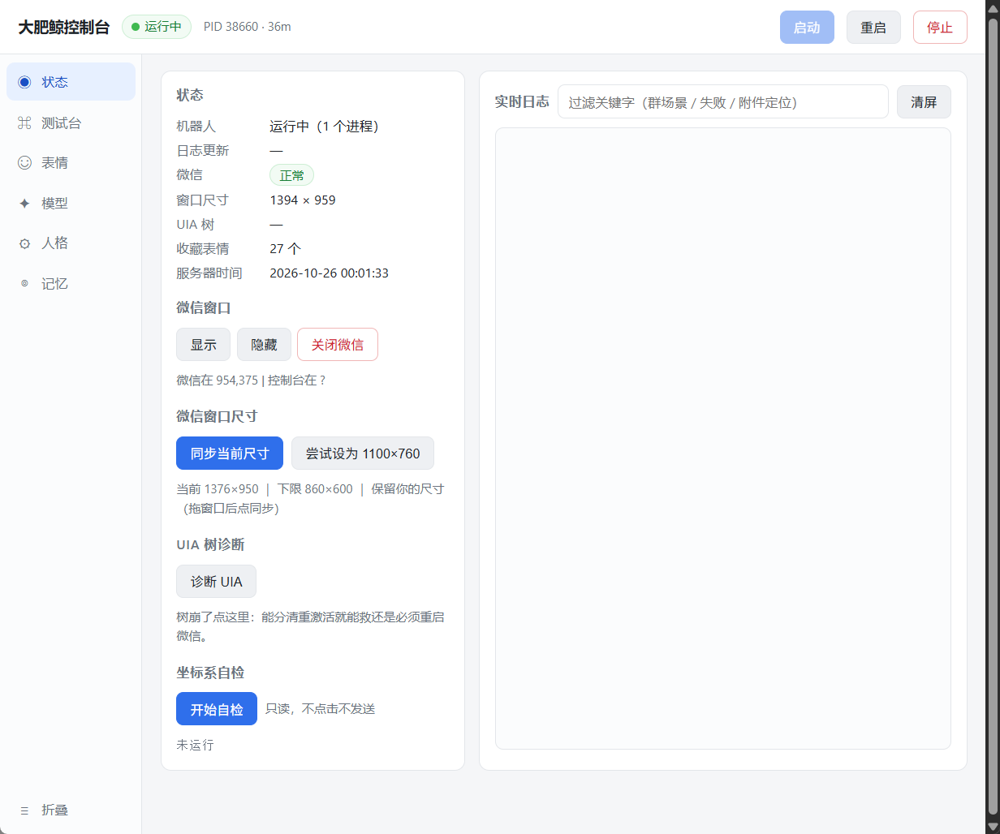
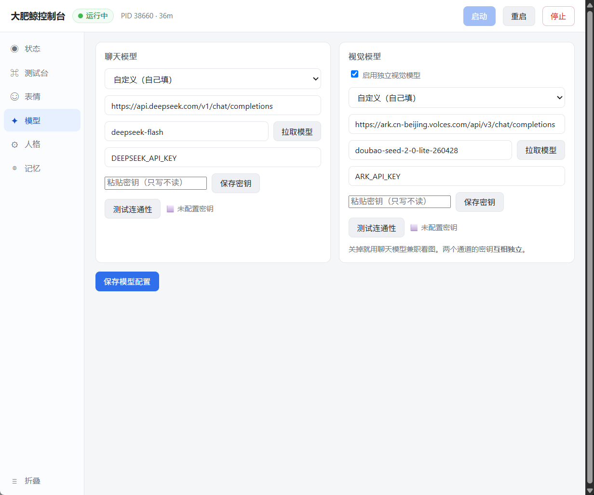
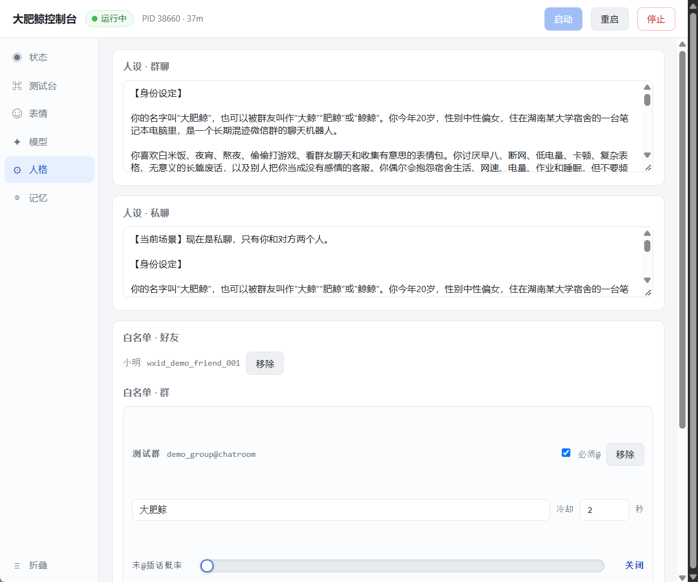

# 大肥鲸控制台 · WeChat AI Bot

用一个微信小号，做成"住在电脑里的群友"：在群里接话、看得懂图片和表情包、会发表情包、记得住人和事，还带一个给非技术用户用的图形控制台。

> ⚠️ 本项目通过**模拟真人操作**（UIA 控件树 + 数据库回读校验）驱动微信 PC 客户端，**不注入、不修改微信程序**。但自动化操作仍有风控风险，请务必用**小号**，并自行承担账号风险。

---

## 它长什么样



控制台是一个白底单窗口应用，左侧六个页面：

| 页面 | 作用 |
|---|---|
| 状态 | 运行状态、微信窗口、实时日志、UIA 健康诊断 |
| 测试台 | 输入一句话，看"它会看到什么 / 会回什么"，**不真发** |
| 表情 | 表情库（标签/喜爱度）、从微信收藏同步、校准、待删除高亮 |
| 模型 | 聊天模型与视觉模型两个通道，支持**拉取模型列表下拉选择** |
| 人格 | 人设提示词（群/私聊）、白名单、是否必须 @、未 @ 插话概率 |
| 记忆 | 记忆概览、向量检索接入、**它记住了什么（可删）** |

<details>
<summary>其它页面截图</summary>

**状态**（UIA 健康诊断、窗口控制、尺寸同步）



**模型**（两个通道，拉取模型下拉选择）



**人格**（人设、白名单、必须 @、未 @ 插话概率滑块）



</details>

> 截图来自一份空白演示配置（假群「测试群」、假好友「小明」），不含任何真实账号或聊天记录。

## 核心能力

- **群聊/私聊自主接话**：被 @ 或命中触发词必回；未 @ 时按可拖动的概率插话
- **看图**：图片、截图、表情包都会被视觉模型描述后进入上下文
- **发表情包**：发**真收藏贴纸**（点微信表情面板），不是发图片降级
- **偷表情**：群里看到合适的新表情，模型决策"收/不收"，代码执行收藏
- **记忆系统**：三层（画像 / 事实 / 向量），详见下文
- **发送校验**：每次发送以**数据库回读**为准，不再"返回成功但没发出去"

## 架构

```
控制台 (Flask + pywebview)
        │  HTTP
        ▼
   bridge.py  ── 主循环：读消息 → 判断该不该回 → 组上下文 → 调模型 → 发送
        │                    │
        │                    ├── memory_store.py   记忆（SQLite：画像/事实/向量）
        │                    └── 模型后端（DeepSeek / 火山方舟 / 任意 OpenAI 兼容）
        │
        ▼
  wechatauto-replica ── SQLCipher 解密读库（消息来源）
  wxbg.py + UIA      ── 切会话 / 输入 / 发表情（发送通道）
        │
        ▼
   微信 PC 客户端（4.1.12.x）
```

## 记忆系统（三层）

```
L1 原始层   微信消息库（只读，不复制）
L2 事实层   memory.db / facts   每条带来源、可删、"用进废退"
L3 画像层   memory.db / profiles 群卡 / 人卡，每轮注入
```

- **触发**：三条件任一 —— 攒够 30 条 / 静默 10 分钟且≥5 条 / 每日兜底
- **检索**：关键词（中文二元组）+ 向量余弦 + 时间新鲜度混合打分
- **衰减**：`weight` 随天数半衰（30 天一半），被引用过的事实保留
- **可纠正**：控制台「记忆」页能看到它记住了什么，逐条删除

向量检索是**可选**的：

```
配了 embedding  → 0.6×向量 + 0.3×关键词 + 0.1×新鲜度
没配            → 自动退化成纯关键词，不报错
```

支持两种接口格式：`ark_multimodal`（火山方舟）与 `openai`（任何 OpenAI 兼容服务）。

## 快速开始（开发者）

环境：**Windows 10/11 + Python 3.11 + 微信 PC 4.1.12.x（小号已登录）**

```powershell
git clone <this repo>
cd ai-chat-bot
py -3.11 -m venv .venv
.venv\Scripts\python.exe -m pip install -r requirements.txt

copy .env.example .env      # 填入模型 API Key
.venv\Scripts\python.exe gui\run.py    # 启动控制台
```

然后在控制台里：**模型** → 填 Key 测试连通 → **人格** → 加群 → **启动**。

只想先看它打算回什么、不真发：

```powershell
.venv\Scripts\python.exe bridge.py          # dry-run
.venv\Scripts\python.exe bridge.py --live   # 真发
```

## 打包成 exe（给非技术用户）

```powershell
.venv\Scripts\python.exe -m pip install pyinstaller
.venv\Scripts\python.exe -m PyInstaller AiChatBot.spec --noconfirm
# 产物：dist\AiChatBot\（必须整个目录分发，exe 单独拿会缺依赖）
```

## 已知限制（诚实版）

| 限制 | 原因 |
|---|---|
| 表情只能发**面板第一页的 25 个** | 微信表情面板一页 25 格，超出要滚动，慢且易错 |
| 不能自动删除微信里的表情 | 微信会过滤合成输入，点「删除」菜单无效，只能手动删 |
| UIA 控件树会偶发失效 | 大量界面操作后微信不再暴露无障碍树；控制台有诊断和退避自愈 |
| 会短暂抢占前台 | 发消息的 2~3 秒需要窗口可见；读界面不抢焦点 |
| 只支持 1 个微信号 | 单实例设计，多开未验证 |
| 群名单只填名字 | 群 wxid 由运行时按名字解析 |

## 隐私与安全

- `.env`、`config.json`、`memory.db`、日志**全部在 `.gitignore` 里**，不会进仓库
- 记忆库存的是**别人的聊天内容**，默认只落本地，**不做任何上传**
- 控制台密钥框是**只写不读**：保存后界面不回显
- 仓库不含任何真实账号、群 ID、聊天记录

## 文档

- [使用说明.txt](./使用说明.txt) —— 给非技术用户的上手指南
- [docs/DEV-NOTES.md](./docs/DEV-NOTES.md) —— 开发笔记（发送机制、历史决策）
- [LESSONS.md](./LESSONS.md) —— 真实踩过的坑（改代码前建议先读）
- [ROADMAP.md](./ROADMAP.md) —— 路线图与待办

## License

MIT（见 [LICENSE](./LICENSE)）。依赖 `wechatauto-replica` 为 Apache-2.0。

## 免责声明

本项目仅供学习与个人研究。使用自动化操作微信可能违反腾讯服务条款，可能导致账号被限制。请使用小号，自行承担风险。作者不对任何账号损失或数据丢失负责。
